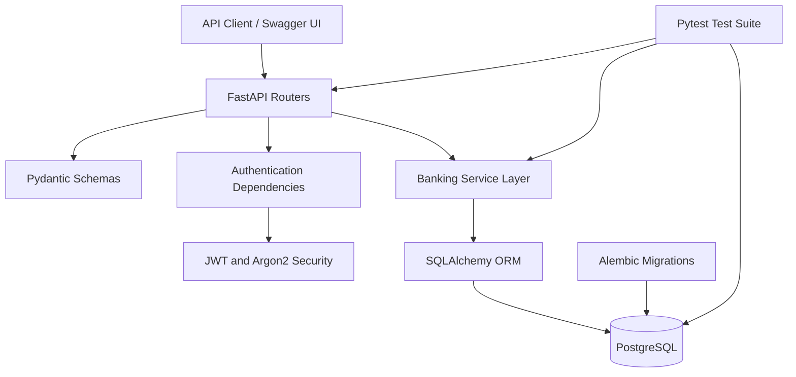
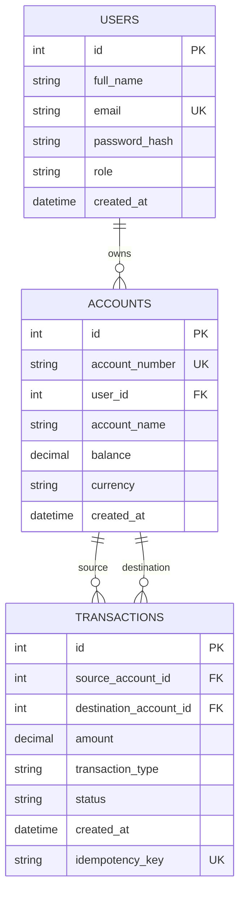
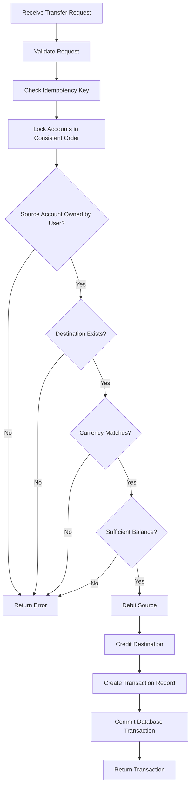
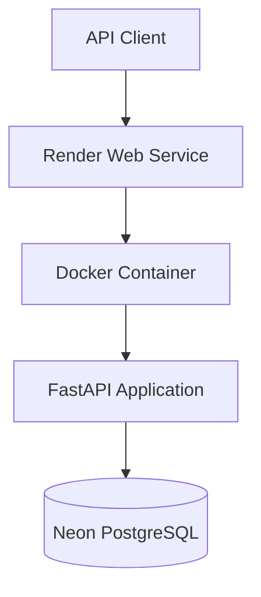

# System Architecture

# API Reference

Interactive documentation:
https://digital-banking-backend-gctw.onrender.com/docs

Live API:
https://digital-banking-backend-gctw.onrender.com

Health check:
https://digital-banking-backend-gctw.onrender.com/health

The OpenAPI specification is available at `/openapi.json`.

## 1. Application Overview

The Digital Banking Backend follows a layered architecture built with FastAPI, SQLAlchemy, and PostgreSQL.

## 2. Layer Responsibilities

| Layer | Responsibility |
|---|---|
| Routers | HTTP endpoints and request handling |
| Schemas | Request validation and response serialization |
| Services | Banking business logic |
| Models | SQLAlchemy database entities |
| Dependencies | Database sessions and authentication |
| Security | Password hashing and JWT handling |
| Exception Handlers | Consistent API error responses |
| Migrations | Database schema versioning |
| Tests | Functional, security, and concurrency verification |

## 3. Database Design

The system uses three principal entities:

- Users
- Accounts
- Transactions

A user can own multiple accounts.

Transactions reference the relevant source and destination accounts according to the transaction type.

## 4. Transfer Processing

A transfer must debit one account and credit another without allowing inconsistent intermediate results.

## 5. Transaction Reliability

The banking service uses:

- Database transactions to group related updates.
- PostgreSQL row-level locking to protect account balances.
- Consistent account-lock ordering during transfers.
- Idempotency keys to prevent duplicate operations.
- Database constraints to protect stored data.
- Decimal-based monetary values to avoid floating-point arithmetic errors.

## 6. Authentication and Authorization

Authentication uses:

- Argon2 password hashing.
- JWT access tokens.
- Token signature validation.
- Token expiration validation.
- Authenticated-user dependencies.
- Role-based administrative authorization.
- Account ownership checks.

## 7. Testing Architecture

The project uses Pytest and HTTPX.

The test suite covers:

- User registration and authentication.
- Authorization and ownership restrictions.
- Account creation and management.
- Deposits, withdrawals, and transfers.
- Idempotency behavior.
- Database constraints.
- Exception handling.
- Concurrent transaction behavior.

The application and test environments use separate databases.

## 8. Deployment Architecture

Docker packages the application.

Render hosts the API.

Neon provides hosted PostgreSQL.

Alembic manages database migrations.

## 9. Scope and Limitations

This is an educational backend implementation.

It does not provide real payment settlement, external banking network connectivity, regulatory compliance certification, or production-grade financial infrastructure.

| `GET` | `/health` | Database connectivity health check | Health |