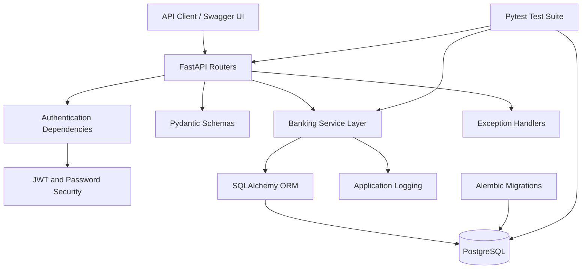
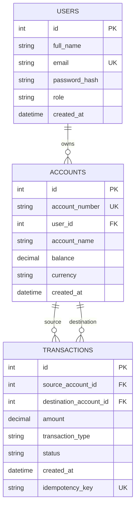
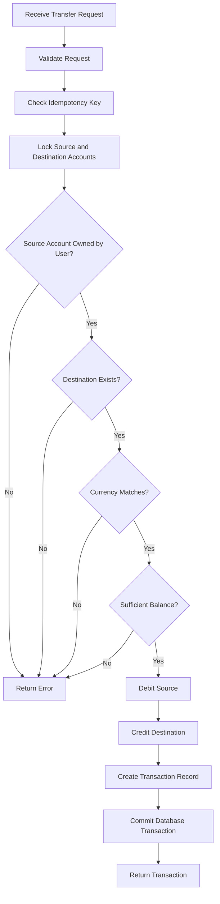

# System Architecture

## 1. Application Architecture



## 2. Layer Responsibilities

| Layer | Responsibility |
|---|---|
| Routers | HTTP endpoints and request handling |
| Schemas | Request validation and response serialization |
| Services | Banking business logic |
| Models | SQLAlchemy database entities |
| Dependencies | Database sessions and authentication |
| Security | Password hashing and JWT handling |
| Exception Handlers | Consistent API error responses |
| Migrations | Database schema versioning |
| Tests | Functional, security and concurrency verification |

## 3. Database ER Diagram



## 4. Transfer Processing Flow



## 5. Transaction Reliability

```
The banking service uses:

- Database transactions to group related updates.
- Row-level locking to protect account balances.
- Consistent lock ordering during transfers.
- Idempotency keys to prevent duplicate operations.
- Database constraints to protect stored data.

The project is an educational implementation. External banking integrations, payment settlement, regulatory controls, and production operational safeguards are outside its current scope.
```

Rather than manually guessing endpoint paths, we'll generate documentation directly from FastAPI's OpenAPI schema. This ensures the published API reference matches your actual routers.