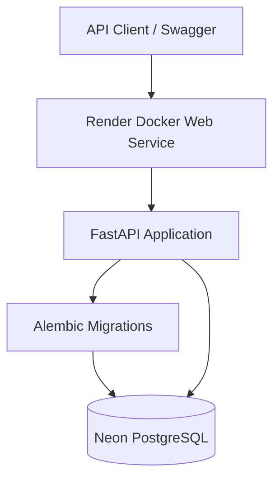

# Deployment Guide

## Deployment Architecture

The application uses Docker for containerization and is deployed on Render.

Neon provides the hosted PostgreSQL database.



## Local Docker Setup

Requirements:

- Docker Desktop
- Docker Compose
- Environment variables configured in `.env`

Start:

```bash
docker compose up --build -d
```

Check:

```bash
docker compose ps
docker compose logs api
```

Stop:

```bash
docker compose down
```

## Hosted Deployment

Application hosting: Render

Database hosting: Neon PostgreSQL

Container runtime: Docker

Application server: Uvicorn

Database migration: Alembic

## Required Environment Variables

- DB_USER
- DB_PASSWORD
- DB_HOST
- DB_PORT
- DB_NAME
- DB_SSLMODE
- JWT_SECRET_KEY
- JWT_ALGORITHM
- ACCESS_TOKEN_EXPIRE_MINUTES

Secrets must be configured through the hosting provider's environment settings.

Never commit production secrets to GitHub.

## Health Verification

The deployed service exposes:

- `/` — application status
- `/health` — application and database connectivity
- `/docs` — Swagger UI
- `/openapi.json` — OpenAPI specification

## Deployment Limitations

The free hosting configuration is intended for educational demonstration and portfolio verification.

It is not a production banking deployment.

Free compute can sleep, database resources have usage limits, and availability is not guaranteed.
